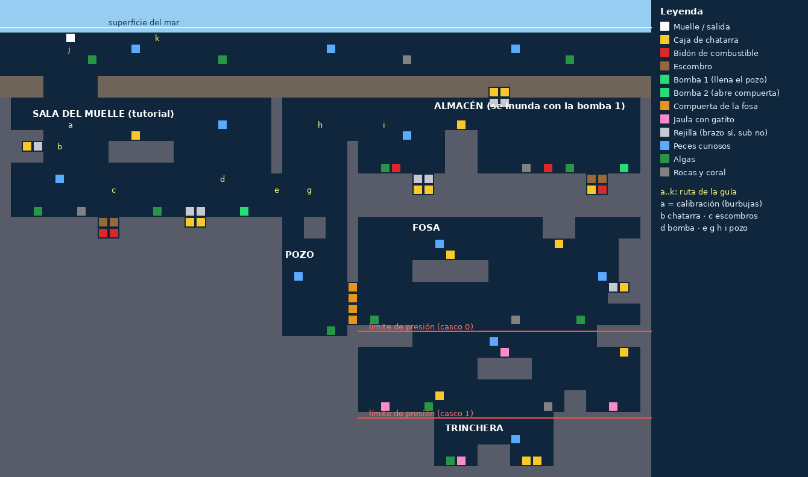
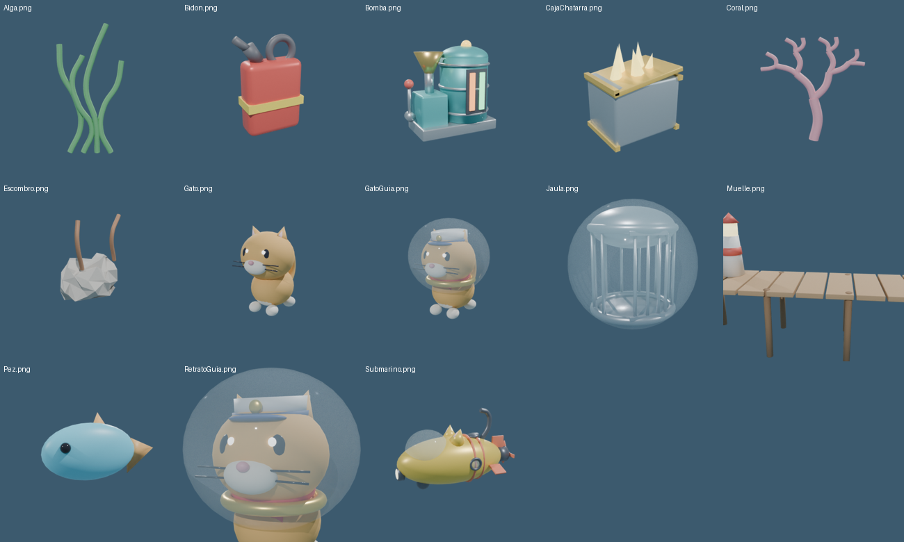

# Cat Squad: Rescate Profundo

> **Novedad — Etapa 1 de la versión final (primera persona).** El paquete ahora trae DOS escenas que
> conviven en el mismo proyecto:
>
> - **CatSquad → Construir escena Rescate Profundo**: la vista lateral del **Avance 1** (sin cambios de comportamiento).
> - **CatSquad → Construir escena 3D (primera persona)**: Gatópolis, la ciudad inundada, vista desde la cabina.
>
> Cada una guarda su progreso por separado, así que la demo del Avance 1 no se ve afectada.

## Lab 05 — Predicción de trayectoria (movimiento parabólico) ⭐ lo más nuevo

Todo comparte un núcleo: `Scripts/Trajectory/TrajectoryMath.cs` → **p(t) = p0 + u·sm·t + ½·g·t²**.
Ese mismo archivo trae el tiempo de caída, la solución de disparo y la gravedad efectiva bajo el agua.
La explicación completa para el informe está en `Docs/LAB05_Prediccion_Trayectoria.md`.

### 2D — minijuego "El Muelle" (lo que pide el enunciado)
**CatSquad → Lab 05: Construir minijuego 2D (El Muelle)** crea la escena `Scenes/Muelle2D` y la agrega al final del Build.

| Paso del lab | En El Muelle |
|---|---|
| Muros con Box Collider 2D | Muros de piedra, el faro del centro, el muelle y el edificio |
| Taza (Cup) con Rigidbody 2D + Edge Collider 2D | Cesta sobre una balsa que flota (Rigidbody 2D cinemático que sube, baja y deriva) |
| Bola con Rigidbody 2D + Circle Collider 2D | El ovillo |
| Physics Material 2D "Rebote" | `Minijuego2D/Rebote.physicsMaterial2D` (rebote 0.6, fricción 0.4) |
| `Ball.cs`, `Trajectory.cs`, GameManager | `Ball.cs`, `Trajectory.cs`, `MuelleGameManager.cs`, con los mismos métodos que el lab |
| Ejercicio 2: otro objetivo | Balde en la azotea (3 puntos) |
| Ejercicio 3: puntuación | Puntos, aciertos de tiros, racha (3 o más: puntos dobles) |
| Ejercicio 4: *Calculating Trajectories* | **A** muestra el arco guía (solución de disparo), **Espacio** hace el tiro automático (además predice dónde estará la balsa) y **T** activa los puntos con rebotes (escena de física paralela) |

Para jugar: presiona, arrastra hacia atrás y suelta. **1/2** o **Tab** cambian de blanco y **R** reinicia el puntaje.

### 3D — dentro de Gatópolis (vuelve a construir la escena 3D)
- **Lanzador neumático** en la proa. Se abre con el nuevo botón **LANZAR** del panel (o **G**).
  Mientras está abierto el submarino queda quieto y la pinza en reposo.
- **Resortera bimanual.** La mano del panel se apoya y la del brazo agarra (clic / cerrar la mano), tira hacia atrás y suelta.
  - Si tiras hacia abajo, el tiro sale más alto. Si tiras hacia un lado, sale hacia el otro.
  - Más tirón da más fuerza.
  - Los **puntos** muestran el vuelo predicho y el **anillo** marca dónde caerá. Se ponen verdes si vas a acertar.
- **En la superficie** se lanzan **latas de atún** a las cestas de los gatitos con hambre.
  Hay 2 cestas junto a la base, para probar apenas empieza la partida, y 3 alrededor de cada balsa.
- **Bajo el agua** el juego elige solo el proyectil:
  - **Lastre** (hierro, g_ef ≈ 0.87·g): cae en arco sobre las **placas** del fondo.
  - **Boya** (g_ef = −g): **sube** en parábola invertida hasta los **ganchos** bajo las pasarelas flotantes.
  - Ambos están en el mar abierto, cerca de la base.
  - El agua frena (arrastre), así que se predice simulando paso a paso.
- **La IA usa la predicción:**
  - Los **peces** van con ARRIVE al punto donde la lata **entrará** al agua y se la comen.
  - La **gata guía** hace FLEE si un lastre va a caer donde está.
- **Panel del terapeuta (F1) → Lanzador:**
  - **Ayuda:** ninguna / arco guía / imán (corrige el tiro si se parece al ideal) / automática.
  - Se puede exigir la palanca.
  - Se ajusta el tirón necesario para la fuerza máxima.
- **Métricas:** cada tiro es una repetición (`lanzamiento_lata/lastre/boya`). El resumen trae las columnas
  `lanzamientos, aciertos, asistidos, tiron_medio`, y el CSV anterior se guarda aparte.

## Etapa 1 — Primera persona

- **Mundo 3D** generado desde el mismo mapa ASCII: el complejo tiene 10 m de fondo y techos y suelos
  reales. El mar abierto mide 50 m de fondo, y hay lámparas en los pasillos y rejillas con barrotes en 3D.
- **Cabina**: vista desde la cúpula con tablero, marco de ventana y la **palanca** (se inclina con el timón).
- **Mapa abatible**: una pantallita cuelga de un brazo mecánico del techo y muestra el mapa simplificado
  con el submarino (punto amarillo, con la proa en rojo) y la guía (naranja). Se muestra y se guarda
  con **M** (o Tab). En la etapa 3 se abrirá juntando las manos, con el panel y los pulgares.
- **Timón** (equivalente en teclado de los gestos acordados):

| Gesto acordado | Teclado |
|---|---|
| Mano vertical (como un "like" sin pulgar) = avanzar | W |
| Pulgar arriba = retroceder | S |
| Mano a los lados = girar | A / D |
| Levantar la mano = subir (y palanca de bomba) | Espacio |
| Abrir la mano = bajar | Shift o C |

- **Brazo en 3D**: la mano mueve la pinza arriba, abajo y a los lados, con el mismo alcance medido que antes.
  La pinza **se extiende sola** hacia el objeto que tiene delante.
- **Anclaje de trabajo (usa ARRIVE)**: al acercarte despacio a una caja o a un cerrojo, el submarino llega
  solo a una pose desde la que el objetivo queda al **70–90 % del alcance**. La dirección va rotando
  (arriba, a los lados, en diagonal) para trabajar distintos movimientos. En 3D reemplaza a las "corrientes"
  de la vista lateral. Las bombas se anclan igual. Para soltarte: gira o avanza.
- Los fragmentos de chatarra vuelan **hacia la cabina** (Seek) y la guía nada **delante** de ti para que la veas.

## Etapa 4 — Gestos con la webcam y calibración por gesto

**Actualiza también `VisionBridge/catsquad_pose_bridge.py`**: el puente ahora mide la forma de cada mano.

- **Python solo mide** (en 3D, con los landmarks "world" de MediaPipe, así no importa si los dedos apuntan a la cámara):
  - la dirección de la palma (normal);
  - cuánto se estira cada dedo y la apertura de la mano;
  - si el pulgar se separa de la palma (palma abajo) o apunta hacia arriba (mano de canto);
  - el meñique y el centro de cada mano.
- **Unity interpreta** con un **reconocedor por plantillas** (`GestureRecognizer`):
  - elige el gesto más parecido de cada mano;
  - solo acepta un cambio de gesto si se mantiene un momento;
  - trae plantillas por defecto, pero lo ideal es **calibrar los gestos de cada niño**.

| Gesto | Mano | Qué hace |
|---|---|---|
| Palma abajo, relajada (no hace falta cerrar el puño) | panel | Timón quieto: a los lados gira, subir la mano sube (y es la palanca de bombas y esclusas) |
| Palma abajo y mano ABIERTA | panel | Baja |
| Mano DE CANTO (un "like" sin pulgar) | panel | Avanza mientras se mantiene |
| De canto con el PULGAR ARRIBA | panel | Retrocede |
| JUNTAR las manos | ambas | Abre o cierra el panel de la cabina |
| Palmas abajo + un pulgar levantado | izq. / der. | Mueve la selección del panel a ese lado |
| AMBOS pulgares levantados | ambas | Confirma el botón |
| Cerrar / abrir la mano | brazo | Cierra / abre la pinza (umbral calibrado) |
| Meñique arriba (opcional, se activa en F1) | panel | Pide una pista a la guía |

- **Calibración por gesto** (F1 → **Calibrar gestos (webcam)**, con el puente funcionando):
  - Un asistente pide cada gesto: reposo, pulgares arriba, mano abierta, de canto, de canto con pulgar, puño y mano abierta del brazo, manos juntas y meñique (opcional).
  - Para cada gesto da 3 s para acomodarse y graba 2 s.
  - Guarda cómo lo hace **ese niño** (plantilla media) y ajusta los umbrales de la pinza y de "manos juntas".
  - Si la cámara no ve bien la mano, repite el paso solo. Se puede saltar, repetir o cancelar.
  - El juego queda en pausa mientras dura.
- **F1** muestra en vivo el gesto de cada mano (con su distancia a la plantilla), el estado del timón y la distancia entre las manos. Ahí también se pueden borrar las plantillas.
- **Modo demo sin cámara:** `python catsquad_pose_bridge.py --demo`.
  - Envía un guion con todos los gestos: quieto, avanzar, retroceder, subir, bajar, girar, juntar las manos, pulgar derecho, pulgar izquierdo, ambos pulgares y alcanzar/agarrar.
  - La consola dice cuál está haciendo.
- **Verificación:**
  - Se armaron manos sintéticas de 21 puntos (palma abajo, abierta, de canto, de canto con pulgar, pulgar levantado) para ambas manos, y se pasaron por el puente.
  - El reconocedor de C# acertó 200 de 200 en cada gesto, con ruido de ±0,2 en la normal y ±0,1 en los demás rasgos.
  - El modo demo se probó recibiendo sus paquetes por UDP.

## Etapa 3 — Panel de la cabina manejado con los pulgares

Vuelve a construir la escena 3D (el panel se agrega a la cabina).

- **Un solo panel real junto a la palanca.**
  - Arriba muestra el **nivel** (y si está liberado) y la **profundidad actual / máxima** (en rojo cerca del límite).
  - Al centro está el **mapa lateral**.
  - Abajo hay **5 botones**:

| Botón | Qué hace |
|---|---|
| AUTO | Cambia entre modo manual y automático (el terapeuta puede bloquearlo en F1) |
| LUCES | Faro alto: el foco llega más lejos |
| PISTA | La guía señala el siguiente objetivo (o la esclusa si el barrio ya está listo) |
| ZOOM | Aleja o acerca la cámara del mapa lateral |
| BALSA | El riel lleva al submarino a la balsa de rescate del barrio |

- **Gestos** (en teclado, para probar):

| Gesto acordado | Teclado |
|---|---|
| Juntar las manos: desplegar o plegar el panel | M o Tab |
| Manos relajadas, palma abajo, pulgar DERECHO arriba: selección a la derecha | X |
| Pulgar IZQUIERDO arriba: selección a la izquierda | Z |
| AMBOS pulgares arriba (un momento): confirmar | Z+X a la vez (o Enter) |

- **Intérprete único de pulgares** (en `BimanualInput`), el mismo para teclado y webcam:
  - Un pulgar solo mueve la selección una vez.
  - Si el otro pulgar sube en menos de 0,25 s, es un acorde, y sostenido 0,35 s confirma.
  - Un acorde soltado antes de tiempo no hace nada.
  - Hay que bajar ambos pulgares para el siguiente gesto.
  - En el panel, dos marcas (IZQ/DER) se encienden con cada pulgar y una barra muestra el progreso de la confirmación.
- **F1 → Panel de cabina (pulgares):**
  - Invertir pulgares.
  - Permitir que el niño active el modo automático.
  - **Confirmar esperando:** tras mover la selección, quedarse quieto N segundos confirma, sin levantar ambos pulgares.
- La ventana F1 ahora se ajusta a la altura de la pantalla y tiene desplazamiento: ya no se corta en pantallas bajas.
- **Métricas nuevas:** movimientos y confirmaciones del panel, en el resumen de la sesión y en el CSV.
- **Tutorial:** al final, la guía enseña el panel y espera a que el niño pruebe un botón.
- La webcam solo tiene que entregar el estado de cada pulgar y si las manos están en reposo. Eso es la **etapa 4**.

## Etapa 2b — Gatópolis, la ciudad inundada (cambios de la retroalimentación)

**Vuelve a construir la escena 3D** y usa **CatSquad → Borrar progreso guardado**: el nivel es nuevo y el
progreso anterior de la versión 3D ya no sirve.

- **Cabeceo:** al bajar, la proa se inclina hacia abajo (hasta unos 35°) para ver a dónde vas. Al subir se
  inclina hacia arriba. Al anclarse o quedarse quieto, el submarino se nivela solo.
- **Mapa = la cámara lateral del primer prototipo.**
  - Una segunda cámara mira la avenida desde el costado, sigue al submarino y se ve en **un solo panel real
    en el tablero, junto a la palanca**. El brazo del techo ya no existe.
  - **M** (o Tab) pliega y despliega el panel.
  - En esa vista se ve al gato piloto dentro de la cúpula. La cabina no aparece (usa las capas 29 "Cabina"
    y 30 "SoloMapa", que el constructor nombra solo si están libres).
- **Mundo abierto: la ciudad inundada.** Primero está el **mar abierto** (nivel 0: arena, rocas y algas). Luego
  vienen **tres barrios bajo el nivel del mar**, separados por diques: Barrio del Puerto, Plaza del Ovillo y
  Torres del Maullido.
  - Los barrios son avenidas con edificios separados por callejones y plazas, faroles y autos. Casi todos los
    edificios quedan bajo el agua y hay agua libre sobre las azoteas.
  - **Cada bomba DRENA un barrio.** El agua baja, los edificios emergen y el barrio queda **liberado**: se
    encienden las ventanas y los faroles.
- **El límite de profundidad se mide desde la superficie del agua local** (18 m, 26 m y 40 m según la mejora
  del casco). Por eso las calles de un barrio solo quedan al alcance después de drenarlo.
- **Esclusas para cambiar de nivel.**
  1. Entra a la cámara y acércate a la boya: el submarino se ancla solo.
  2. **Mantén la palanca** (Espacio, o la mano del panel arriba): el agua de la cámara sube o baja con el
     submarino adentro.
  3. Cuando el agua se iguala con el otro lado, se abre la compuerta. Para salir, gira o avanza.
- **Balsas de rescate:** hay una en cada barrio, que flota sobre su nivel de agua. Los gatitos bajan ahí.
  Al acabarse el oxígeno, el riel lleva al submarino a la balsa del barrio, y la sesión siguiente empieza en
  esa balsa.
- **Rieles:** el modo automático también usa las esclusas. Si no queda nada que hacer en el barrio actual, va a
  la esclusa que lleva a donde hay trabajo, y el niño sostiene la palanca.
- **Cascabeles secretos:** uno está entre las rocas del mar, tres sobre las azoteas (fuera de la avenida) y
  uno en un rincón de la calle.
- **Verificación:** todo compila, y se simuló la alcanzabilidad en cada estado del agua.
  - Los 41 objetivos quedan alcanzables en el orden de progresión.
  - Los postes de las esclusas y las balsas se alcanzan desde ambos lados.
  - Las vistas previas están en `Docs/ciudad_*.png`.

## Etapa 2 — Modo automático con rieles y ayuda del riel

**Hay que volver a construir la escena 3D** (menú *CatSquad → Construir escena 3D (primera persona)*),
porque la escena trae piezas nuevas: la red de rieles, el riel de luz, la baliza y los cascabeles.

- **Dos modos de conducción**, que elige el terapeuta en **F1 → Conducción (primera persona)**. Para probar,
  también se cambia con la tecla **R** (en la etapa 3 pasará al botón del panel de la cabina).
  - **Manual**: se maneja con la palanca, como en la etapa 1.
  - **Automático**: el submarino avanza **despacio** por los rieles y va de objetivo en objetivo. El niño
    solo usa el brazo, y en las bombas también la palanca. Pensado para niños con menos movilidad del lado afectado.
- **Ayuda del riel** (solo en manual): si la palanca queda quieta **N segundos** (por defecto 8; con 0 se
  desactiva), el riel toma el control hasta el siguiente objetivo. **Basta mover la palanca para recuperarlo.**
- **Cómo funciona el riel** (usa Seek y Arrive):
  - El riel es una grilla hecha desde el mismo mapa ASCII.
  - Una celda solo cuenta si está **bajo el agua**, dentro del **límite de presión** del casco y sin la compuerta cerrada.
    Por eso el riel "crece" a medida que se bombea agua y se mejora el submarino.
  - Con **Dijkstra** se elige el objetivo más cercano **por el riel**, no en línea recta a través de las paredes.
  - La ruta se suaviza y se centra en los pasillos angostos. Luego se recorre con **Seek** en los puntos
    intermedios y **Arrive** en el último.
  - Al llegar, el submarino gira la proa hacia el objetivo y **se ancla en la pose de trabajo** (70–90 % del alcance),
    igual que en manual.
  - En los pozos verticales la proa apunta a lo largo del pasillo para que el casco quepa.
- **Qué elige el riel**, en este orden:
  1. Con un bidón en la pinza, va a la bomba que lo necesita.
  2. Si una bomba tiene combustible en el tanque, va a bombear.
  3. Si no, va a la caja, cerrojo o bidón más cercano. Si un escombro tapa el bidón, primero va al escombro.
  4. Con gatitos siguiéndote y sin jaulas a la vista, vuelve al muelle.

  En la primera sesión sigue los pasos del tutorial.
- **Se ve** como un **riel de luz** bajo la cabina, una **baliza** verde sobre el objetivo y un punto verde en el mapa.
- **Secretos**: hay **5 cascabeles dorados** en bolsillos del mapa, lejos de todos los rieles (se verificó
  por simulación). Solo se encuentran **manejando**. Al tocarlos sueltan chatarra extra, la guía felicita al
  niño y se guardan en el progreso.
- **Métricas nuevas**:
  - Modo de conducción, segundos manejando con la palanca, segundos llevado por el riel, veces que actuó la
    ayuda y cascabeles encontrados. Aparecen en el resumen de la sesión y en el CSV.
  - Si ya tenías un `resumen_sesiones.csv` de antes, se renombra a `resumen_sesiones_version_anterior.csv`
    para no mezclar columnas.

**Pendiente (próximas etapas):**
3. Panel de cabina (botón de modo automático y mapa) manejado con los pulgares, juntando las manos para abrirlo.
4. Gestos de la palanca con la webcam (orientación de la mano, pulgar, meñique y manos juntas) con calibración por gesto.
5. Ajustes finales.

También queda pendiente **probar el brazo real con la webcam en la versión del Avance 1**.

---

# Avance 1 (Seek y Arrive) — vista lateral

Prototipo jugable del juego serio descrito en la propuesta: un submarino tripulado por un gato,
controlado con **dos brazos con roles distintos** (panel = mano asistente, brazo robótico = mano
manipuladora), con los algoritmos **Seek** y **Arrive** del Lab 2 aplicados con una función concreta
dentro del juego.



---

## 1. Qué hay en el paquete

```
Assets/CatSquadRP/          ← copiar dentro de la carpeta Assets del proyecto Unity
  Scripts/Steering/         Seek, Arrive, seguimiento de rutas (núcleo del avance)
  Scripts/Input/            Entrada bimanual: teclado+mouse y webcam (UDP)
  Scripts/Gameplay/         Submarino, brazo, objetos, bombas, agua, compuertas, corrientes
  Scripts/Actors/           Gata guía, gatitos, peces, muelle
  Scripts/Tutorial/         Tutorial guiado y calibración con burbujas
  Scripts/Systems/          Sesión/oxígeno, métricas, guardado, cámara, ambiente, audio
  Scripts/UI/               HUD, resumen, taller de mejoras, panel del terapeuta (F1)
  Editor/                   Constructor de escena + mapa ASCII del nivel
  Models/                   Modelos 3D low-poly (FBX) hechos para este juego
  Textures/ Audio/          Texturas procedurales y efectos de sonido
VisionBridge/               ← carpeta aparte (NO va dentro de Assets): puente Python con MediaPipe
Docs/                       Mapa del nivel y vista previa de modelos
```

No se modifica ningún archivo existente del repo. Todo el código nuevo está en el namespace
`CatSquad.RescateProfundo`, así que no choca con `EnemyAI`, `PlayerMovement`, etc.

## 2. Instalación (5 minutos)

1. Cierra Unity (opcional, pero evita reimportaciones a medias).
2. Copia la carpeta `CatSquadRP` dentro de `CatSquadShooter/Assets/`.
3. Abre el proyecto y espera a que termine de importar (los FBX y WAV tardan un poco la primera vez).
4. En la barra de menús: **CatSquad → Construir escena Rescate Profundo**.
   - Crea materiales en `Assets/CatSquadRP/Materials/`, arma la escena completa y la guarda en
     `Assets/CatSquadRP/Scenes/RescateProfundo.unity` (también la añade a Build Settings).
5. Pulsa **Play**.

Requisitos que el proyecto ya cumple: Unity 6 (6000.3) con URP, TextMesh Pro importado y
*Active Input Handling = Both*. No hay que configurar nada a mano.

Otros menús útiles: **CatSquad → Borrar progreso guardado** (para volver a ver el tutorial) y
**CatSquad → Abrir carpeta de métricas**.

## 3. Controles

| Rol (propuesta) | Teclado + mouse | Webcam |
|---|---|---|
| Panel: palancas de desplazamiento (mano asistente) | WASD / flechas | mover el brazo del panel desde la posición de reposo |
| Panel: palanca de la bomba (contracción sostenida) | mantener **Espacio** (o W acoplado) | subir la mano del panel y mantenerla |
| Brazo: alcanzar (mano manipuladora) | el mouse es la mano | extender el brazo hábil |
| Brazo: sujetar / soltar | mantener clic izquierdo / soltar | cerrar / abrir la mano |
| Brazo: verter (rotación de antebrazo) | mantener **E** (o **Q**, o clic derecho) | girar la muñeca |
| Desacoplarse de una bomba | mantener A o D | llevar la mano del panel hacia un lado |
| Simular compensación de tronco (prueba) | mantener **L** | se detecta sola (hombros/caderas) |
| Ayuda / panel del terapeuta | H / F1 | H / F1 |

## 4. Seek y Arrive aplicados al juego (lo que pide el avance)

Implementación con fuerzas de *steering* (Reynolds), en `Scripts/Steering/SteeringBehaviours.cs`:

- **Seek**: `velocidadDeseada = normalizar(objetivo − posición) · vMax`; `fuerza = velocidadDeseada − velocidad`.
  Siempre va a máxima velocidad: llega rápido pero se pasa de largo (sobrepaso).
- **Arrive**: igual que Seek, pero dentro del *radio de frenado* la rapidez deseada es
  `vMax · distancia / radioDeFrenado`, así que desacelera y se detiene exactamente en el objetivo.

En el Lab 2 (`Scenes/NewBehaviourScript.cs`) movíamos con `posición += dirección·speed·dt` y parábamos
de golpe con `distanciaDeParada`. Aquí el movimiento se integra con aceleración limitada
(`SteeringBody.Integrate`), lo que da trayectorias suaves y curvas naturales.

| Dónde | Algoritmo | Por qué ese y no el otro |
|---|---|---|
| **Capitana Pelusa, gata guía del tutorial** (`GuideCat.cs`) | **Arrive** (y ruta = Seek en puntos intermedios + Arrive en el último) | Debe llegar junto a lo que explica y quedarse quieta ahí; un Seek la haría pasarse y orbitar el objetivo. |
| **Pinza del brazo manipulador** (`ManipulatorArm.cs`) | **Arrive** | La mano del niño fija un objetivo; la pinza frena con precisión sobre el objeto y además **filtra el temblor de la estimación de pose** de la webcam. |
| **Gatitos rescatados en fila** (`RescuedKitten.cs`) | **Arrive** | Cada gatito llega a su hueco en el rastro del submarino y se mantiene sin chocar ni adelantarse. |
| **Anclaje de trabajo en 3D** (`ReachAnchor.cs`, `SubmarineController.cs`) | **Arrive** | El submarino llega a la pose de trabajo y se detiene exacto: así el objetivo queda a la distancia terapéutica. |
| **Auto-emersión al acabarse el oxígeno** (`SubmarineController.cs`) | Seek en las migas del rastro + **Arrive** al muelle | Vuelve por el camino que ya recorrió (sin atravesar paredes) y se detiene suave en el muelle. |
| **Fragmentos de chatarra** (`MaterialShard.cs`) | **Seek** | Deben *alcanzar* la compuerta de carga del submarino, no detenerse: el sobrepaso da un vuelo curvo muy visual. |
| **Peces curiosos** (`CuriousFish.cs`) | **Seek** hacia la luz del foco (+ Flee si se acercan demasiado) | Se sienten atraídos por la luz; la mejora de Iluminación los atrae desde más lejos. |

**Para mostrarlo en clase:** en la vista *Scene*, selecciona la guía, un gatito o un pez mientras se
juega: `SteeringAgent` dibuja la velocidad (verde), la fuerza de steering (amarillo), la línea al
objetivo (rojo = Seek, cian = Arrive) y el **radio de frenado** de Arrive (esfera cian).
El brazo dibuja su alcance (círculo exterior) y la banda del 70 % – 90 %.

## 5. Mecánicas implementadas (propuesta → juego)

| Propuesta | Implementación |
|---|---|
| Panel con el lado afectado, brazo con el lado hábil; inversión configurable | `BimanualInput` asigna los roles según *lado afectado* e *invertir roles* (panel F1). |
| Levantar el brazo → alcanzar objetos elevados | Chatarra en nichos del techo tras rejillas. |
| Cruzar la línea media → transportar el bidón | Bidones lejos de las bombas; el bidón sigue a la pinza con física. |
| Girar antebrazo → verter combustible | Rotar la muñeca ≥ 55° sobre el embudo de la bomba. |
| Mover/sujetar → apartar escombros | Escombros pesados que tapan el combustible. |
| Mantener una posición → usar palancas | La bomba solo bombea mientras la palanca está sostenida. |
| Usar ambos brazos → panel + manipulador | Verter exige sostener la palanca a la vez (se puede desactivar en F1). |
| Objetos al 70 – 90 % del alcance | Cada objetivo tiene una **corriente** (anillo) que frena al submarino pero no a la pinza: el hombro del brazo queda a 70 – 90 % del alcance. Como el alcance del brazo = el alcance calibrado del niño, también es el 70 – 90 % de *su* alcance. |
| Calibración integrada en la ficción | "¡Revienta las burbujas!" mide el envolvente por dirección (8 sectores) y crece solo cuando el niño supera su marca. |
| Dosis variable, sin cuota | Cada caja suelta 1 – 5 fragmentos según la extensión relativa al alcance del niño. |
| Compensación de tronco → el objeto resbala | Sin mensajes de error: el objeto simplemente se suelta. |
| Oxígeno = duración de sesión, sin derrota | Al vaciarse, el submarino vuelve solo al muelle y conserva todo. |
| Bombas → nivel del agua → zonas | Bomba 1 llena el pozo (vasos comunicantes con el almacén); bomba 2 abre la compuerta de la fosa. |
| Mejoras: autonomía, iluminación, profundidad | Taller al final de cada sesión (motor, foco, casco). |
| Fase 2: gatitos varados, ninguno sufre daño | Con el casco mejorado se llega a la fosa; se liberan tirando del cerrojo y siguen al submarino hasta el muelle, donde quedan sentados sesión tras sesión. |
| Métricas por sesión | JSON + CSV por repetición + `resumen_sesiones.csv` acumulado. |

## 6. Flujo de una sesión

1. **Primera vez:** tutorial completo con la guía (moverse → calibración → chatarra → escombros →
   bidón → bomba → subir por el pozo). **Siguientes sesiones:** el submarino baja solo, calibración
   corta y a jugar.
2. El oxígeno baja durante el juego (15 min por defecto; 1 – 30 en F1).
3. Al acabarse: el submarino emerge solo, los gatitos que venían en fila saltan al muelle.
4. Resumen (para el niño y para el terapeuta) → Taller → Nueva sesión.

El progreso (chatarra, mejoras, bombas, gatitos rescatados, calibración) se guarda en
`Application.persistentDataPath/catsquad_rescate_profundo.json`.

## 7. Panel del terapeuta (F1) y métricas

Duración, modo de entrada, lado afectado, inversión de roles, exigencia bimanual al verter,
sensibilidad de compensación, saltar tutorial, terminar sesión, reiniciar progreso, +50 chatarra (pruebas).

Métricas en `…/CatSquadSesiones/`: repeticiones, intentos, alcance medio y máximo (normalizado al
alcance calibrado), tiempo por repetición, suavidad (nº de picos de velocidad por alcance),
proporción de intentos con compensación, uso brazo/panel, tiempo de palanca sostenida (y el más largo).

## 8. Webcam (módulo de visión, para Joao)

```bash
cd VisionBridge
pip install -r requirements.txt
python catsquad_pose_bridge.py          # webcam + ventana de vista previa
python catsquad_pose_bridge.py --demo   # sin cámara: brazos simulados, para probar Unity
```
En el juego: F1 → marcar *Usar webcam*. Si no llega señal, el juego sigue con teclado.
La primera vez descarga los modelos de MediaPipe (pose y manos) a `VisionBridge/models/`.
Python solo percibe; la interpretación (alcance, palanca, compensación) está en
`WebcamPoseInputProvider.cs`, con umbrales editables en el Inspector.

## 9. El nivel: de tiles a mapa ASCII con bloques fusionados

El sistema anterior instanciaba un prefab por celda. Ahora el nivel es un mapa ASCII en vista lateral
(`Editor/LevelLayout.cs`) y el constructor **fusiona las celdas de pared en rectángulos grandes**
(algoritmo greedy): unas decenas de cajas en vez de cientos de tiles, con UV en coordenadas de mundo
para que la textura no se estire. Para editar el nivel: cambia el mapa y vuelve a usar el menú.

## 10. Modelos

Todos los modelos (submarino-gato, gatos, guía con escafandra, pez, bomba, bidón, caja, escombro,
jaula, muelle, algas, rocas, coral) se generaron para este proyecto, así que no tienen problemas de
licencia. No usé el gato SWAT con pistola del repo como protagonista porque el público son niños
en terapia; se puede cambiar si el equipo prefiere otra cosa. Para reemplazar un modelo, sustituye el
FBX con el mismo nombre (y, si quieres conservar los colores, nombra sus materiales igual).



## 11. Si algo sale mal (para la retroalimentación)

- **El submarino o un gato mira hacia atrás:** gira `Submarino/Visual/ModelPivot` 180° en Y (o el
  hijo `Visual` del gato). Depende de cómo Unity lea los ejes del FBX.
- **Materiales rosados:** el proyecto no está usando URP; revisa *Project Settings → Graphics*.
- **Textos invisibles:** *Window → TextMeshPro → Import TMP Essential Resources*.
- **Errores de compilación:** envíame el primer error de la consola (archivo y línea).
- **Algo se ve fuera de lugar:** una captura de la vista *Scene* con el objeto seleccionado ayuda mucho.
